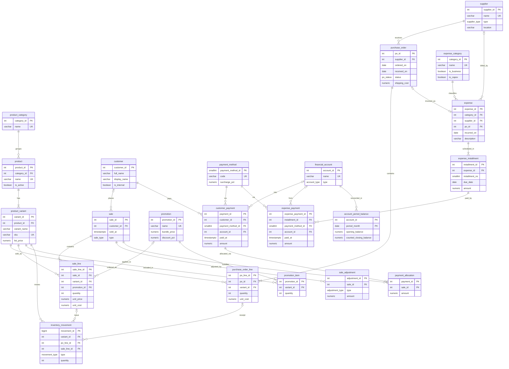

# Triple B — Relational Database Specification

**Source workbook:** `CONTROL MATES TRIPLE B SEPTIEMBRE (1).xlsx` (September 2026)
**Target platform:** PostgreSQL 14+
**Normalization target:** Third Normal Form (3NF)

---

## Table of Contents

1. [Data Profiling & Entity Extraction](#1-data-profiling--entity-extraction)
2. [Responsibility Segregation (Normalization)](#2-responsibility-segregation-normalization)
3. [Relationship Mapping](#3-relationship-mapping)
4. [Schema Definition](#4-schema-definition)
5. [ER Diagram (Mermaid)](#5-er-diagram-mermaid)
6. [PostgreSQL DDL](#6-postgresql-ddl)
7. [Migration Mapping & Cleanup Notes](#7-migration-mapping--cleanup-notes)

---

## 1. Data Profiling & Entity Extraction

### 1.1 Source sheets and what they actually contain

| Sheet | Nominal purpose | What it actually mixes |
|---|---|---|
| **STOCK** (152 rows) | Inventory | Product catalog + variant (model/colour/size) + supplier + goods receipt (date, units) + stock on hand + cost + list price + card price + profit report |
| **VENTAS** (~168 rows) | Sales | Sale header + line item + customer + payment method + payment status + deposit (ENTREGA), plus total rows and a JSON copy of each row in column Z |
| **CUENTAS PENDIENTES** | Accounts receivable | Second, hand-kept copy of credit sales: customer header rows, line items and subtotal rows interleaved, plus 10% interest |
| **BALANCE** | Balance | Supplier purchases + instalment plans (CUOTAS) + loans + payment status, plus a monthly cash count (Lemon wallet, cash, savings) in rows 31–40 |
| **GASTOS** | Expenses | Operating costs and personal spending (food, donations) with no category |
| **PEDIDOS** | Purchase orders | Orders to suppliers, with the supplier written as a section-header row ("MATES GUAY") instead of a column |
| **PROMOS** | Promotions | Scratchpad of bundle prices with no product references |

### 1.2 Anomalies and overlapping responsibilities

**Repeated data / one row doing several jobs**
- STOCK has 44 repeated product names (e.g., `BEERMAT` appears as both `STELLA` and `BUDWEISSER`) because product and variant are flattened into one row.
- The supplier is stored per stock row, but the same item comes from different suppliers (bombillas from MERCADO LIBRE, ALTOS MATES and BUENA YERBA). The supplier belongs to the purchase, not to the product.

**Calculated values stored as data**
- `STOCK` (stock on hand) is typed in by hand and is not linked to sales.
- `VENTA CC TC GO` (`=H*1.1` card price), `GANANCIA X U`, `GASTO TOTAL`, `GANANCIA TOTAL` and `NETO` are all derivable. `GASTO TOTAL` is actually cost × remaining stock, not total spend.
- `ESTADO DE PAGO` (payment status) is derivable from payments.

**The same fact stored twice**
- Credit sales exist in both VENTAS and CUENTAS PENDIENTES (e.g., INDRA's Yerba Baldo / Pindare / Tazas Patagonia).
- VENTAS column Z repeats product, model and quantity as a JSON string.

**Several values in one cell**
- Payment methods such as `TRANSF/EFEC` and `EFECTIVO/TRANSFERENCIA` are split payments in a single field.
- Status `SEÑADO 50%` is a deposit hidden inside a status value.

**Wrong data type**
- BALANCE `CUOTAS` (instalment count) holds date serials (46175, 46083, 46113, 46174), while totals hard-code the count (`=D2*6`, `=D3*3`, `=E5/4`).

**Fragile totals**
- Totals are long hand-picked cell lists (VENTAS row 173 "TOTAL PAGADO", BALANCE row 28, GASTOS row 49).
- Hard-coded corrections inside formulas (`-4000`, `+15000`, `+35000` in BALANCE B39).
- BALANCE labels `VENTAS!G173` (money collected) as "GANANCIA VENTAS" (sales profit).

**Inconsistent names**
- Trailing spaces (`"YERBA BALDO "`), spelling variants (`TRANF` / `TRANSFERENCIA`).
- Likely duplicate customers (`INDRA` vs `INDRA NAVARRO`, `LAU BARCENA` vs `LAURA BARCENA`).
- Pseudo-customers: internal (`NOSOTROS`) and giveaway (`LINA (SORTEO)`).

**Business rules hidden in formulas**
- 10% card surcharge (`=H*0.1+H`), 10% late interest (CUENTAS PENDIENTES E5), lot cost split (`=76040.19/24`).

---

## 2. Responsibility Segregation (Normalization)

### 2.1 Extracted entities

| Domain | Entities |
|---|---|
| Catalog | `product_category`, `product`, `product_variant` |
| Purchasing | `supplier`, `purchase_order`, `purchase_order_line` |
| Inventory | `inventory_movement` (stock ledger; on-hand is derived) |
| Sales | `customer`, `sale`, `sale_line`, `sale_adjustment`, `promotion`, `promotion_item` |
| Receivables | `customer_payment`, `payment_allocation` (replaces CUENTAS PENDIENTES) |
| Payables / Expenses | `expense_category`, `expense`, `expense_installment`, `expense_payment` |
| Treasury | `payment_method`, `financial_account`, `account_period_balance` |

### 2.2 Design decisions

- **No stored derivations.** Payment status, stock on hand, totals and profit are computed by views, eliminating hand-picked total formulas.
- **Deliberate historical snapshot.** `sale_line.unit_cost` copies the cost at the time of sale (old `MONTO MAYOR` column) so historical margins don't change when costs change. This is a point-in-time fact, not redundancy.
- **Supplier ↔ product is N:M**, realised through `purchase_order_line`.
- **Payments are separate from sales.** A payment can settle several sales and a sale can be paid in parts (deposits, split methods) via `payment_allocation`.
- **Instalments are rows, not a count.** `expense_installment` replaces CUOTAS / MONTO DE CUOTAS / VENCIMIENTO; status is derived from `expense_payment`.
- **Personal vs business spending** is separated by `expense_category.is_business`; capex ("INVERSIONES") by `is_capex`.
- **Business rules become data.** Card surcharge lives in `payment_method.surcharge_pct`; interest is a `sale_adjustment` row.

---

## 3. Relationship Mapping

| Relationship | Cardinality | Key link |
|---|---|---|
| product_category → product | 1:N | `product.category_id` |
| product → product_variant | 1:N | `product_variant.product_id` |
| supplier → purchase_order | 1:N | `purchase_order.supplier_id` |
| purchase_order → purchase_order_line | 1:N | `purchase_order_line.po_id` |
| supplier ↔ product_variant | N:M | via `purchase_order_line` |
| customer → sale | 1:N (optional customer for walk-ins) | `sale.customer_id` |
| sale → sale_line | 1:N | `sale_line.sale_id` |
| sale ↔ product_variant | N:M | via `sale_line` |
| promotion → sale_line | 1:N (optional) | `sale_line.promotion_id` |
| promotion ↔ product_variant | N:M | via `promotion_item` (composite PK) |
| sale → sale_adjustment | 1:N | `sale_adjustment.sale_id` |
| customer → customer_payment | 1:N | `customer_payment.customer_id` |
| customer_payment ↔ sale | N:M | via `payment_allocation` (composite PK) |
| payment_method → customer_payment / expense_payment | 1:N | `payment_method_id` |
| financial_account → customer_payment / expense_payment | 1:N (optional) | `account_id` |
| product_variant → inventory_movement | 1:N | `inventory_movement.variant_id` |
| purchase_order_line → inventory_movement | 1:N (optional) | `inventory_movement.po_line_id` |
| sale_line → inventory_movement | 1:N (optional) | `inventory_movement.sale_line_id` |
| expense_category → expense | 1:N | `expense.category_id` |
| supplier → expense | 1:N (optional) | `expense.supplier_id` |
| purchase_order → expense | 1:0..1 | `expense.po_id` (UNIQUE) |
| expense → expense_installment | 1:N | `expense_installment.expense_id` |
| expense_installment → expense_payment | 1:N | `expense_payment.installment_id` |
| financial_account → account_period_balance | 1:N | composite PK `(account_id, period_month)` |

---

## 4. Schema Definition

Conventions: surrogate keys use `GENERATED ALWAYS AS IDENTITY`; money uses `NUMERIC(12,2)`; timestamps use `TIMESTAMPTZ`.

### 4.1 Enumerated types

| Type | Values |
|---|---|
| `supplier_type` | MERCHANDISE, MARKETPLACE, SERVICE, PERSON, OTHER |
| `po_status` | DRAFT, ORDERED, RECEIVED, CANCELLED |
| `sale_type` | REGULAR, WHOLESALE, GIFT, GIVEAWAY, INTERNAL |
| `adjustment_type` | INTEREST, DISCOUNT, CARD_SURCHARGE, WRITE_OFF |
| `movement_type` | PURCHASE_RECEIPT, SALE, GIFT, RETURN, ADJUSTMENT, DAMAGE |
| `account_type` | CASH, BANK, DIGITAL_WALLET, SAVINGS |

### 4.2 Tables

#### `payment_method`
| Column | Type | Constraints |
|---|---|---|
| payment_method_id | SMALLINT | PK, identity |
| code | VARCHAR(20) | NOT NULL, UNIQUE (CASH, TRANSFER, CARD) |
| name | VARCHAR(50) | NOT NULL |
| surcharge_pct | NUMERIC(5,4) | NOT NULL, DEFAULT 0, CHECK ≥ 0 (card = 0.10) |

#### `financial_account`
| Column | Type | Constraints |
|---|---|---|
| account_id | INT | PK, identity |
| name | VARCHAR(60) | NOT NULL, UNIQUE |
| type | account_type | NOT NULL |
| is_active | BOOLEAN | NOT NULL, DEFAULT TRUE |

#### `product_category`
| Column | Type | Constraints |
|---|---|---|
| category_id | INT | PK, identity |
| name | VARCHAR(60) | NOT NULL, UNIQUE |

#### `product`
| Column | Type | Constraints |
|---|---|---|
| product_id | INT | PK, identity |
| category_id | INT | FK → product_category |
| name | VARCHAR(120) | NOT NULL, UNIQUE |
| is_active | BOOLEAN | NOT NULL, DEFAULT TRUE |
| created_at | TIMESTAMPTZ | NOT NULL, DEFAULT now() |

#### `product_variant`
| Column | Type | Constraints |
|---|---|---|
| variant_id | INT | PK, identity |
| product_id | INT | NOT NULL, FK → product (RESTRICT) |
| variant_name | VARCHAR(80) | NOT NULL, DEFAULT 'STANDARD' |
| sku | VARCHAR(40) | UNIQUE |
| list_price | NUMERIC(12,2) | NOT NULL, CHECK ≥ 0 |
| is_active | BOOLEAN | NOT NULL, DEFAULT TRUE |
| | | UNIQUE (product_id, variant_name) |

#### `supplier`
| Column | Type | Constraints |
|---|---|---|
| supplier_id | INT | PK, identity |
| name | VARCHAR(100) | NOT NULL, UNIQUE |
| type | supplier_type | NOT NULL, DEFAULT 'MERCHANDISE' |
| location | VARCHAR(80) | |
| notes | TEXT | |

#### `purchase_order`
| Column | Type | Constraints |
|---|---|---|
| po_id | INT | PK, identity |
| supplier_id | INT | NOT NULL, FK → supplier |
| ordered_on | DATE | NOT NULL, DEFAULT CURRENT_DATE |
| received_on | DATE | CHECK ≥ ordered_on |
| status | po_status | NOT NULL, DEFAULT 'DRAFT' |
| shipping_cost | NUMERIC(12,2) | NOT NULL, DEFAULT 0, CHECK ≥ 0 |
| notes | TEXT | |

#### `purchase_order_line`
| Column | Type | Constraints |
|---|---|---|
| po_line_id | INT | PK, identity |
| po_id | INT | NOT NULL, FK → purchase_order (CASCADE) |
| variant_id | INT | NOT NULL, FK → product_variant |
| quantity | INT | NOT NULL, CHECK > 0 |
| unit_cost | NUMERIC(12,2) | NOT NULL, CHECK ≥ 0 |

#### `customer`
| Column | Type | Constraints |
|---|---|---|
| customer_id | INT | PK, identity |
| full_name | VARCHAR(120) | NOT NULL |
| display_name | VARCHAR(60) | nickname, e.g. 'TIA LORE' |
| phone | VARCHAR(30) | |
| is_internal | BOOLEAN | NOT NULL, DEFAULT FALSE ('NOSOTROS') |
| notes | TEXT | |
| created_at | TIMESTAMPTZ | NOT NULL, DEFAULT now() |

#### `promotion`
| Column | Type | Constraints |
|---|---|---|
| promotion_id | INT | PK, identity |
| name | VARCHAR(100) | NOT NULL, UNIQUE |
| bundle_price | NUMERIC(12,2) | CHECK ≥ 0 |
| discount_pct | NUMERIC(5,4) | CHECK 0–1 |
| valid_from | DATE | |
| valid_to | DATE | CHECK ≥ valid_from |
| | | CHECK exactly one of bundle_price / discount_pct |

#### `promotion_item`
| Column | Type | Constraints |
|---|---|---|
| promotion_id | INT | PK, FK → promotion (CASCADE) |
| variant_id | INT | PK, FK → product_variant |
| quantity | INT | NOT NULL, DEFAULT 1, CHECK > 0 |

#### `sale`
| Column | Type | Constraints |
|---|---|---|
| sale_id | INT | PK, identity |
| customer_id | INT | FK → customer (NULL = walk-in) |
| sold_at | TIMESTAMPTZ | NOT NULL, DEFAULT now() |
| type | sale_type | NOT NULL, DEFAULT 'REGULAR' |
| notes | TEXT | |

#### `sale_line`
| Column | Type | Constraints |
|---|---|---|
| sale_line_id | INT | PK, identity |
| sale_id | INT | NOT NULL, FK → sale (CASCADE) |
| variant_id | INT | NOT NULL, FK → product_variant |
| promotion_id | INT | FK → promotion |
| quantity | INT | NOT NULL, CHECK > 0 |
| unit_price | NUMERIC(12,2) | NOT NULL, CHECK ≥ 0 (0 for gifts) |
| unit_cost | NUMERIC(12,2) | NOT NULL, CHECK ≥ 0 (snapshot at sale time) |

#### `sale_adjustment`
| Column | Type | Constraints |
|---|---|---|
| adjustment_id | INT | PK, identity |
| sale_id | INT | NOT NULL, FK → sale (CASCADE) |
| type | adjustment_type | NOT NULL |
| amount | NUMERIC(12,2) | NOT NULL, CHECK ≠ 0 (signed: +interest, −discount) |
| applied_at | TIMESTAMPTZ | NOT NULL, DEFAULT now() |
| notes | TEXT | |

#### `customer_payment`
| Column | Type | Constraints |
|---|---|---|
| payment_id | INT | PK, identity |
| customer_id | INT | FK → customer |
| payment_method_id | SMALLINT | NOT NULL, FK → payment_method |
| account_id | INT | FK → financial_account |
| paid_at | TIMESTAMPTZ | NOT NULL, DEFAULT now() |
| amount | NUMERIC(12,2) | NOT NULL, CHECK > 0 |
| notes | TEXT | |

#### `payment_allocation`
| Column | Type | Constraints |
|---|---|---|
| payment_id | INT | PK, FK → customer_payment (CASCADE) |
| sale_id | INT | PK, FK → sale |
| amount | NUMERIC(12,2) | NOT NULL, CHECK > 0 |

#### `inventory_movement`
| Column | Type | Constraints |
|---|---|---|
| movement_id | BIGINT | PK, identity |
| variant_id | INT | NOT NULL, FK → product_variant |
| moved_at | TIMESTAMPTZ | NOT NULL, DEFAULT now() |
| type | movement_type | NOT NULL |
| quantity | INT | NOT NULL, CHECK ≠ 0 (+in / −out) |
| po_line_id | INT | FK → purchase_order_line; required iff type = PURCHASE_RECEIPT |
| sale_line_id | INT | FK → sale_line; required iff type ∈ (SALE, GIFT, RETURN) |
| notes | TEXT | e.g. 'PINCHADO' (damaged) |

#### `expense_category`
| Column | Type | Constraints |
|---|---|---|
| category_id | INT | PK, identity |
| name | VARCHAR(60) | NOT NULL, UNIQUE |
| is_business | BOOLEAN | NOT NULL, DEFAULT TRUE |
| is_capex | BOOLEAN | NOT NULL, DEFAULT FALSE |

#### `expense`
| Column | Type | Constraints |
|---|---|---|
| expense_id | INT | PK, identity |
| category_id | INT | NOT NULL, FK → expense_category |
| supplier_id | INT | FK → supplier |
| po_id | INT | UNIQUE, FK → purchase_order |
| incurred_on | DATE | NOT NULL, DEFAULT CURRENT_DATE |
| description | VARCHAR(200) | NOT NULL |

#### `expense_installment`
| Column | Type | Constraints |
|---|---|---|
| installment_id | INT | PK, identity |
| expense_id | INT | NOT NULL, FK → expense (CASCADE) |
| installment_no | SMALLINT | NOT NULL, DEFAULT 1, CHECK > 0 |
| due_date | DATE | NOT NULL |
| amount | NUMERIC(12,2) | NOT NULL, CHECK > 0 |
| | | UNIQUE (expense_id, installment_no) |

#### `expense_payment`
| Column | Type | Constraints |
|---|---|---|
| expense_payment_id | INT | PK, identity |
| installment_id | INT | NOT NULL, FK → expense_installment |
| payment_method_id | SMALLINT | NOT NULL, FK → payment_method |
| account_id | INT | FK → financial_account |
| paid_at | TIMESTAMPTZ | NOT NULL, DEFAULT now() |
| amount | NUMERIC(12,2) | NOT NULL, CHECK > 0 |

#### `account_period_balance`
| Column | Type | Constraints |
|---|---|---|
| account_id | INT | PK, FK → financial_account |
| period_month | DATE | PK, CHECK first day of month |
| opening_balance | NUMERIC(14,2) | NOT NULL |
| counted_closing_balance | NUMERIC(14,2) | |

### 4.3 Derived views

| View | Replaces |
|---|---|
| `v_stock_on_hand` | STOCK column F (manual stock count) |
| `v_sale_balance` | VENTAS ESTADO DE PAGO, TOTAL PAGADO, CUENTAS PENDIENTES subtotals |
| `v_expense_installment_status` | BALANCE ESTADO / FECHA DE PAGO |

### 4.4 Rules requiring triggers

- Sum of `payment_allocation.amount` per payment must not exceed `customer_payment.amount`.
- Stock on hand per variant must not go below zero.

---

## 5. ER Diagram (Mermaid)



---

## 6. PostgreSQL DDL

```sql
-- ===== Enumerated types =====
CREATE TYPE supplier_type   AS ENUM ('MERCHANDISE','MARKETPLACE','SERVICE','PERSON','OTHER');
CREATE TYPE po_status       AS ENUM ('DRAFT','ORDERED','RECEIVED','CANCELLED');
CREATE TYPE sale_type       AS ENUM ('REGULAR','WHOLESALE','GIFT','GIVEAWAY','INTERNAL');
CREATE TYPE adjustment_type AS ENUM ('INTEREST','DISCOUNT','CARD_SURCHARGE','WRITE_OFF');
CREATE TYPE movement_type   AS ENUM ('PURCHASE_RECEIPT','SALE','GIFT','RETURN','ADJUSTMENT','DAMAGE');
CREATE TYPE account_type    AS ENUM ('CASH','BANK','DIGITAL_WALLET','SAVINGS');

-- ===== Reference / lookup =====
CREATE TABLE payment_method (
    payment_method_id SMALLINT GENERATED ALWAYS AS IDENTITY PRIMARY KEY,
    code              VARCHAR(20)  NOT NULL UNIQUE,
    name              VARCHAR(50)  NOT NULL,
    surcharge_pct     NUMERIC(5,4) NOT NULL DEFAULT 0 CHECK (surcharge_pct >= 0)
);

CREATE TABLE financial_account (
    account_id   INT GENERATED ALWAYS AS IDENTITY PRIMARY KEY,
    name         VARCHAR(60)  NOT NULL UNIQUE,
    type         account_type NOT NULL,
    is_active    BOOLEAN      NOT NULL DEFAULT TRUE
);

-- ===== Catalog =====
CREATE TABLE product_category (
    category_id  INT GENERATED ALWAYS AS IDENTITY PRIMARY KEY,
    name         VARCHAR(60) NOT NULL UNIQUE
);

CREATE TABLE product (
    product_id   INT GENERATED ALWAYS AS IDENTITY PRIMARY KEY,
    category_id  INT REFERENCES product_category(category_id),
    name         VARCHAR(120) NOT NULL UNIQUE,
    is_active    BOOLEAN      NOT NULL DEFAULT TRUE,
    created_at   TIMESTAMPTZ  NOT NULL DEFAULT now()
);

CREATE TABLE product_variant (
    variant_id    INT GENERATED ALWAYS AS IDENTITY PRIMARY KEY,
    product_id    INT NOT NULL REFERENCES product(product_id) ON DELETE RESTRICT,
    variant_name  VARCHAR(80)   NOT NULL DEFAULT 'STANDARD',
    sku           VARCHAR(40)   UNIQUE,
    list_price    NUMERIC(12,2) NOT NULL CHECK (list_price >= 0),
    is_active     BOOLEAN       NOT NULL DEFAULT TRUE,
    UNIQUE (product_id, variant_name)
);

-- ===== Purchasing =====
CREATE TABLE supplier (
    supplier_id  INT GENERATED ALWAYS AS IDENTITY PRIMARY KEY,
    name         VARCHAR(100)  NOT NULL UNIQUE,
    type         supplier_type NOT NULL DEFAULT 'MERCHANDISE',
    location     VARCHAR(80),
    notes        TEXT
);

CREATE TABLE purchase_order (
    po_id          INT GENERATED ALWAYS AS IDENTITY PRIMARY KEY,
    supplier_id    INT NOT NULL REFERENCES supplier(supplier_id),
    ordered_on     DATE          NOT NULL DEFAULT CURRENT_DATE,
    received_on    DATE,
    status         po_status     NOT NULL DEFAULT 'DRAFT',
    shipping_cost  NUMERIC(12,2) NOT NULL DEFAULT 0 CHECK (shipping_cost >= 0),
    notes          TEXT,
    CHECK (received_on IS NULL OR received_on >= ordered_on)
);

CREATE TABLE purchase_order_line (
    po_line_id  INT GENERATED ALWAYS AS IDENTITY PRIMARY KEY,
    po_id       INT NOT NULL REFERENCES purchase_order(po_id) ON DELETE CASCADE,
    variant_id  INT NOT NULL REFERENCES product_variant(variant_id),
    quantity    INT           NOT NULL CHECK (quantity > 0),
    unit_cost   NUMERIC(12,2) NOT NULL CHECK (unit_cost >= 0)
);

-- ===== Sales =====
CREATE TABLE customer (
    customer_id   INT GENERATED ALWAYS AS IDENTITY PRIMARY KEY,
    full_name     VARCHAR(120) NOT NULL,
    display_name  VARCHAR(60),
    phone         VARCHAR(30),
    is_internal   BOOLEAN      NOT NULL DEFAULT FALSE,
    notes         TEXT,
    created_at    TIMESTAMPTZ  NOT NULL DEFAULT now()
);

CREATE TABLE promotion (
    promotion_id  INT GENERATED ALWAYS AS IDENTITY PRIMARY KEY,
    name          VARCHAR(100) NOT NULL UNIQUE,
    bundle_price  NUMERIC(12,2) CHECK (bundle_price >= 0),
    discount_pct  NUMERIC(5,4)  CHECK (discount_pct BETWEEN 0 AND 1),
    valid_from    DATE,
    valid_to      DATE,
    CHECK (num_nonnulls(bundle_price, discount_pct) = 1),
    CHECK (valid_to IS NULL OR valid_to >= valid_from)
);

CREATE TABLE promotion_item (
    promotion_id  INT NOT NULL REFERENCES promotion(promotion_id) ON DELETE CASCADE,
    variant_id    INT NOT NULL REFERENCES product_variant(variant_id),
    quantity      INT NOT NULL DEFAULT 1 CHECK (quantity > 0),
    PRIMARY KEY (promotion_id, variant_id)
);

CREATE TABLE sale (
    sale_id      INT GENERATED ALWAYS AS IDENTITY PRIMARY KEY,
    customer_id  INT REFERENCES customer(customer_id),
    sold_at      TIMESTAMPTZ NOT NULL DEFAULT now(),
    type         sale_type   NOT NULL DEFAULT 'REGULAR',
    notes        TEXT
);

CREATE TABLE sale_line (
    sale_line_id  INT GENERATED ALWAYS AS IDENTITY PRIMARY KEY,
    sale_id       INT NOT NULL REFERENCES sale(sale_id) ON DELETE CASCADE,
    variant_id    INT NOT NULL REFERENCES product_variant(variant_id),
    promotion_id  INT REFERENCES promotion(promotion_id),
    quantity      INT           NOT NULL CHECK (quantity > 0),
    unit_price    NUMERIC(12,2) NOT NULL CHECK (unit_price >= 0),
    unit_cost     NUMERIC(12,2) NOT NULL CHECK (unit_cost  >= 0)
);

CREATE TABLE sale_adjustment (
    adjustment_id  INT GENERATED ALWAYS AS IDENTITY PRIMARY KEY,
    sale_id        INT NOT NULL REFERENCES sale(sale_id) ON DELETE CASCADE,
    type           adjustment_type NOT NULL,
    amount         NUMERIC(12,2)   NOT NULL CHECK (amount <> 0),
    applied_at     TIMESTAMPTZ     NOT NULL DEFAULT now(),
    notes          TEXT
);

-- ===== Receivables =====
CREATE TABLE customer_payment (
    payment_id         INT GENERATED ALWAYS AS IDENTITY PRIMARY KEY,
    customer_id        INT REFERENCES customer(customer_id),
    payment_method_id  SMALLINT NOT NULL REFERENCES payment_method(payment_method_id),
    account_id         INT REFERENCES financial_account(account_id),
    paid_at            TIMESTAMPTZ   NOT NULL DEFAULT now(),
    amount             NUMERIC(12,2) NOT NULL CHECK (amount > 0),
    notes              TEXT
);

CREATE TABLE payment_allocation (
    payment_id  INT NOT NULL REFERENCES customer_payment(payment_id) ON DELETE CASCADE,
    sale_id     INT NOT NULL REFERENCES sale(sale_id),
    amount      NUMERIC(12,2) NOT NULL CHECK (amount > 0),
    PRIMARY KEY (payment_id, sale_id)
);

-- ===== Inventory ledger =====
CREATE TABLE inventory_movement (
    movement_id   BIGINT GENERATED ALWAYS AS IDENTITY PRIMARY KEY,
    variant_id    INT NOT NULL REFERENCES product_variant(variant_id),
    moved_at      TIMESTAMPTZ   NOT NULL DEFAULT now(),
    type          movement_type NOT NULL,
    quantity      INT           NOT NULL CHECK (quantity <> 0),
    po_line_id    INT REFERENCES purchase_order_line(po_line_id),
    sale_line_id  INT REFERENCES sale_line(sale_line_id),
    notes         TEXT,
    CHECK ((type = 'PURCHASE_RECEIPT') = (po_line_id IS NOT NULL)),
    CHECK ((type IN ('SALE','GIFT','RETURN')) = (sale_line_id IS NOT NULL))
);

-- ===== Payables & expenses =====
CREATE TABLE expense_category (
    category_id  INT GENERATED ALWAYS AS IDENTITY PRIMARY KEY,
    name         VARCHAR(60) NOT NULL UNIQUE,
    is_business  BOOLEAN     NOT NULL DEFAULT TRUE,
    is_capex     BOOLEAN     NOT NULL DEFAULT FALSE
);

CREATE TABLE expense (
    expense_id   INT GENERATED ALWAYS AS IDENTITY PRIMARY KEY,
    category_id  INT  NOT NULL REFERENCES expense_category(category_id),
    supplier_id  INT  REFERENCES supplier(supplier_id),
    po_id        INT  UNIQUE REFERENCES purchase_order(po_id),
    incurred_on  DATE NOT NULL DEFAULT CURRENT_DATE,
    description  VARCHAR(200) NOT NULL
);

CREATE TABLE expense_installment (
    installment_id  INT GENERATED ALWAYS AS IDENTITY PRIMARY KEY,
    expense_id      INT NOT NULL REFERENCES expense(expense_id) ON DELETE CASCADE,
    installment_no  SMALLINT      NOT NULL DEFAULT 1 CHECK (installment_no > 0),
    due_date        DATE          NOT NULL,
    amount          NUMERIC(12,2) NOT NULL CHECK (amount > 0),
    UNIQUE (expense_id, installment_no)
);

CREATE TABLE expense_payment (
    expense_payment_id  INT GENERATED ALWAYS AS IDENTITY PRIMARY KEY,
    installment_id      INT NOT NULL REFERENCES expense_installment(installment_id),
    payment_method_id   SMALLINT NOT NULL REFERENCES payment_method(payment_method_id),
    account_id          INT REFERENCES financial_account(account_id),
    paid_at             TIMESTAMPTZ   NOT NULL DEFAULT now(),
    amount              NUMERIC(12,2) NOT NULL CHECK (amount > 0)
);

-- ===== Monthly cash reconciliation =====
CREATE TABLE account_period_balance (
    account_id               INT  NOT NULL REFERENCES financial_account(account_id),
    period_month             DATE NOT NULL CHECK (period_month = date_trunc('month', period_month)::date),
    opening_balance          NUMERIC(14,2) NOT NULL,
    counted_closing_balance  NUMERIC(14,2),
    PRIMARY KEY (account_id, period_month)
);

-- ===== Indexes on foreign keys =====
CREATE INDEX ON product_variant (product_id);
CREATE INDEX ON purchase_order (supplier_id);
CREATE INDEX ON purchase_order_line (po_id);
CREATE INDEX ON sale (customer_id, sold_at);
CREATE INDEX ON sale_line (sale_id);
CREATE INDEX ON sale_line (variant_id);
CREATE INDEX ON payment_allocation (sale_id);
CREATE INDEX ON inventory_movement (variant_id, moved_at);
CREATE INDEX ON expense_installment (due_date);
CREATE INDEX ON expense_payment (installment_id);

-- ===== Derived views =====
CREATE VIEW v_stock_on_hand AS
SELECT v.variant_id, p.name AS product, v.variant_name,
       COALESCE(SUM(m.quantity), 0) AS on_hand
FROM product_variant v
JOIN product p USING (product_id)
LEFT JOIN inventory_movement m USING (variant_id)
GROUP BY v.variant_id, p.name, v.variant_name;

CREATE VIEW v_sale_balance AS
WITH l AS (SELECT sale_id, SUM(quantity*unit_price) gross, SUM(quantity*unit_cost) cost
           FROM sale_line GROUP BY sale_id),
     a AS (SELECT sale_id, SUM(amount) adj  FROM sale_adjustment    GROUP BY sale_id),
     p AS (SELECT sale_id, SUM(amount) paid FROM payment_allocation GROUP BY sale_id)
SELECT s.sale_id, s.customer_id, s.sold_at, s.type,
       COALESCE(l.gross,0) + COALESCE(a.adj,0)                       AS total_due,
       COALESCE(p.paid,0)                                            AS total_paid,
       COALESCE(l.gross,0) + COALESCE(a.adj,0) - COALESCE(p.paid,0)  AS outstanding,
       COALESCE(l.gross,0) - COALESCE(l.cost,0)                      AS gross_margin,
       CASE WHEN s.type IN ('GIFT','GIVEAWAY')                         THEN 'N/A'
            WHEN COALESCE(p.paid,0) = 0                                THEN 'PENDING'
            WHEN COALESCE(p.paid,0) < COALESCE(l.gross,0)+COALESCE(a.adj,0) THEN 'PARTIAL'
            ELSE 'PAID' END                                          AS payment_status
FROM sale s
LEFT JOIN l USING (sale_id) LEFT JOIN a USING (sale_id) LEFT JOIN p USING (sale_id);

CREATE VIEW v_expense_installment_status AS
SELECT i.*, COALESCE(SUM(ep.amount),0) AS paid,
       CASE WHEN COALESCE(SUM(ep.amount),0) >= i.amount THEN 'PAID'
            WHEN i.due_date < CURRENT_DATE              THEN 'OVERDUE'
            ELSE 'PENDING' END AS status
FROM expense_installment i
LEFT JOIN expense_payment ep USING (installment_id)
GROUP BY i.installment_id;
```

---

## 7. Migration Mapping & Cleanup Notes

### 7.1 Source → target mapping

| Source | Columns | Target |
|---|---|---|
| STOCK | PRODUCTO, MODELO | `product.name`, `product_variant.variant_name` |
| STOCK | VENTA | `product_variant.list_price` |
| STOCK | PROVEEDOR, INGRESO, UNIDADES, COSTO | `supplier`, `purchase_order` (received_on), `purchase_order_line` (quantity, unit_cost) + `inventory_movement` (PURCHASE_RECEIPT) |
| STOCK | STOCK, VENTA CC TC GO, GANANCIA X U, GASTO TOTAL, GANANCIA TOTAL, NETO | Not stored — derived (`v_stock_on_hand`, `payment_method.surcharge_pct`, `v_sale_balance`) |
| VENTAS | PRODUCTO, MODELO, CANTIDAD, MONTO, MONTO MAYOR | `sale_line` (variant_id, quantity, unit_price, unit_cost) |
| VENTAS | CLIENTE, FECHA | `customer`, `sale.sold_at` |
| VENTAS | ENTREGA, FORMA DE PAGO | `customer_payment` + `payment_allocation` (split payments → multiple rows) |
| VENTAS | ESTADO DE PAGO | Not stored — `v_sale_balance.payment_status` |
| VENTAS | REGALO / SORTEO rows | `sale.type` = GIFT / GIVEAWAY, `unit_price` = 0 |
| VENTAS | Column Z (JSON) | Dropped (duplicate) |
| CUENTAS PENDIENTES | All | Replaced by `v_sale_balance`; INTERESES → `sale_adjustment` (INTEREST) |
| BALANCE rows 2–27 | GASTOS/INVERSIONES, DISTRIBUIDORA | `expense` (+ `expense_category`, `supplier`) |
| BALANCE rows 2–27 | CUOTAS, MONTO DE CUOTAS, VENCIMIENTO | `expense_installment` rows |
| BALANCE rows 2–27 | FORMA DE PAGO, FECHA DE PAGO | `expense_payment` |
| BALANCE rows 2–27 | ESTADO | Not stored — `v_expense_installment_status` |
| BALANCE rows 31–40 | MONTO DEL MES PASADO, LEMON, EFECTIVO, AHORRO | `financial_account` + `account_period_balance` |
| GASTOS | FECHA, DESCRIPCION, MONTO, METODO DE PAGO | `expense` + single `expense_installment` + `expense_payment` |
| PEDIDOS | Supplier header rows + lines | `purchase_order` + `purchase_order_line` |
| PROMOS | Bundle prices | `promotion` + `promotion_item` |

### 7.2 Cleanup required before load

1. Trim whitespace and standardise spelling in product, supplier, customer and payment-method names (`TRANF` → `TRANSFERENCIA`, `BUDWEISSER` → `BUDWEISER`, etc.).
2. Merge duplicate customers (e.g., `INDRA` / `INDRA NAVARRO`, `LAU BARCENA` / `LAURA BARCENA`) and flag `NOSOTROS` as internal.
3. Replace date serials in BALANCE `CUOTAS` with the real instalment counts implied by the totals.
4. Split combined payment methods (`TRANSF/EFEC`) into separate payment rows with their actual amounts.
5. Resolve PEDIDOS lines with no product (e.g., row 10, price 46000).
6. Classify GASTOS rows into business vs personal categories.
7. Fix PROMOS C4 (`=C3*0.1-C3` returns a negative value; intended discount formula is likely `=C3-C3*0.1`).